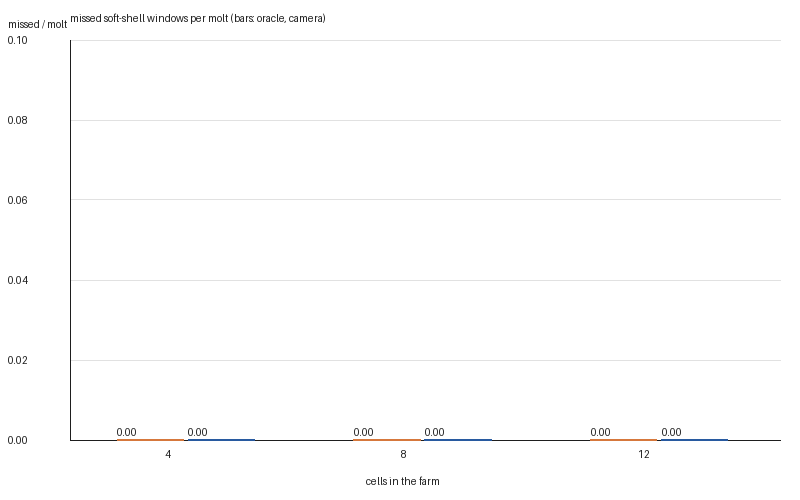
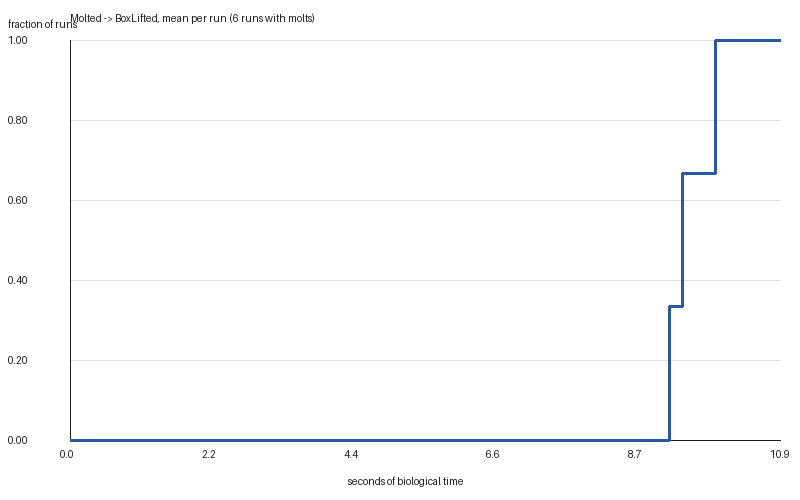
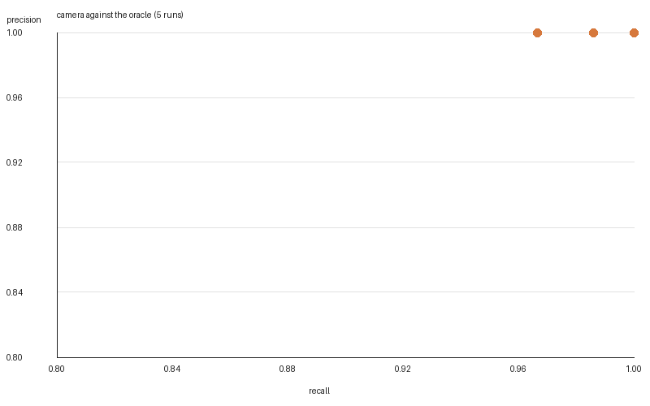
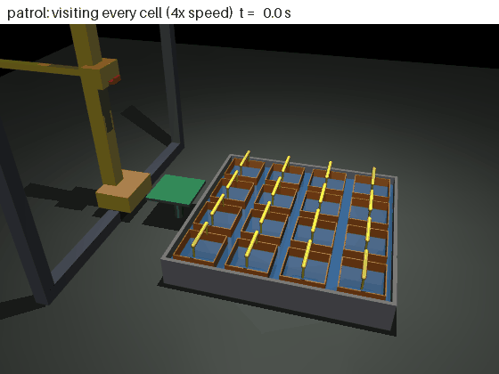
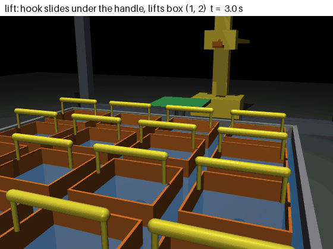
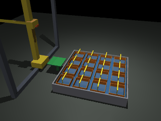
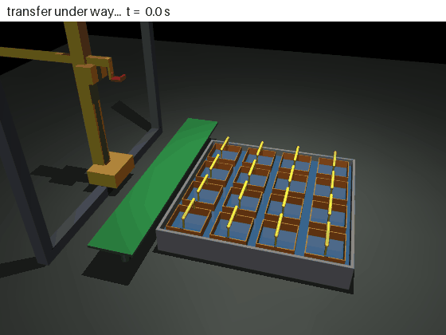
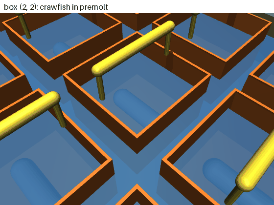
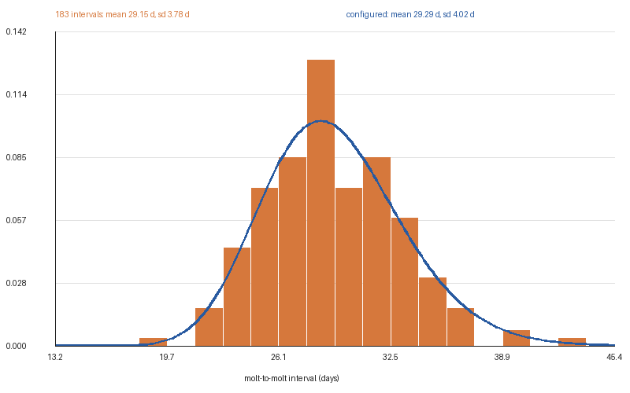

# Rookery

A MuJoCo simulation of a soft-shell crawfish shedding facility, served by a
stacker-crane gantry (`mast`). Crawfish live in mesh boxes on trays, molt on
their own schedule, and must be lifted out within a few hours of molting. The
farm runs itself: a detector (an oracle, or a ray-cast depth camera) spots each
molt, a Lua behavior tree picks the most urgent box, and the crane moves it to
the exit tray.

## The three layers

```text
  Lua      behaviors     lua/trees, lua/leaves: goals only (bb:go_to), read-only blackboard
  Rust     the engine    crates/sim (MuJoCo FFI, all unsafe), mast (kinematics, clamp, commands),
                         bt (behavior trees, mlua), rookery-core (lifecycle, events, vision),
                         rookery (the Integrator: clock, crane, detectors, logs, replay, bench)
  Python   the scenes    scene/: SceneSpec → MJCF (generated, never hand-edited), renders, plots, bench
```

## One command

```bash
cargo run --release -p rookery -- run --config rookery.toml --scenario lua/scenarios/week_1tray.lua --log runs/
```

`rookery.toml` picks the farm (`scene`, `seed`, `detector`, `molt_rate`); point
`scene` at `scene/generated/rack3.xml` for three stacked trays. Every run writes
`runs/<id>/` (summary with metrics, events, `qpos.csv`, `targets.csv`), and
`rookery replay runs/<id>` reproduces it event for event.

## Add a scenario

A scenario is a Lua file under `lua/scenarios/` with a tree, a length and a
`check(log)`:

```lua
ci = true                                   -- run it in CI (scripts/run-scenarios.sh)
scene = "../../scene/generated/rack3.xml"   -- optional; default --scene
tree = "../trees/autonomy.lua"
ticks = 7 * 24 * 3600 * 50                  -- biological time at 50 Hz; the clock fast-forwards
function check(log)                         -- log.events, log.errors, log.visited, ...
  return true, "what passed"
end
```

## Benchmark

```bash
(cd scene && uv run python -m scene.bench ../bench/small.toml --out ../results.csv)
```

```bash
(cd scene && uv run python -m scene.plots results ../results.csv --out-dir ../bench/figures)
```

The small sweep (10 points, under 2 minutes) runs in CI; `bench/large.toml` is
the overnight grid. From the small sweep: no window missed at 4, 8 or 12 cells,
about 10 s from molt to lift, camera precision 1.0 and recall 0.97–1.0.

| | |
|---|---|
|  |  |
|  | |

## Hardware

[`hardware/crane/`](hardware/crane/) is the stacker crane to build: parametric
build123d CAD with a two-stage telescoping fork and a hook camera, the bill of
materials ([`bom.csv`](hardware/crane/bom.csv), about $777), a Klipper
`printer.cfg`, and its own MuJoCo model for a pick-and-place check. It is a
separate Python package with its own CI workflow (`hardware.yml`). The sim
above still drives the old straight arm. Fitting the fork to the sim's rack
comes in later, reviewed changes, and the old arm is kept on the
`backup/old-crane` branch.

```bash
cd hardware/crane
python3 -m venv .venv && source .venv/bin/activate && pip install -e ".[dev]"
python -m pytest -q                       # 44 tests
python -m crane pick                      # headless pick and place
python -m crane view --pick --speed 2     # watch it in the MuJoCo viewer
```

## Setup (macOS)

- MuJoCo 3.16.0: `mujoco.framework` in `~/.mujoco`
- `brew install rustup llvm uv gh`, then `rustup default stable`
- `export LIBCLANG_PATH="$(brew --prefix llvm)/lib"` in your shell profile
- `scripts/worktree-setup.sh` once per checkout, then `cargo build --workspace`

## Run

`rookery <scene.xml>` prints the body count and names, then runs 2 s headless.

Phase 1 demo. This drops a 0.1 m box onto a plane, and the last line is the box's final height (`box z 0.049892`):

```bash
cargo run -p rookery -- scene/generated/drop.xml
```

Phase 2 demo. This builds the farm scene (one tray, 4x4 mesh boxes with hook handles, an exit tray, the crane rails and, since Phase 3, the crane), then loads it (`nbody 55`: world, tray_0, 16 boxes, 16 crawfish, 16 shed shells parked under the tray, and the five crane bodies: truck, carriage, arm, hook and the fork's middle stage). `--crane-look` draws the crane with its CAD meshes from `hardware/crane/meshes/rookery/`; they are look-only, so physics is the same without it:

```bash
(cd scene && uv run python -m scene.cli --trays 1 --cells 4x4 --shelf-gap 0.08 --crane-look)
```

```bash
cargo run -p rookery -- scene/generated/rookery.xml
```

## What it can do

Every clip is a real run, replayed offscreen from its `qpos.csv` log (`scripts/demo_gifs.py`).

| | |
|---|---|
|  | **Patrol** (Phase 4). A Lua behavior tree sends the crane to every cell in turn; Rust plans and clamps each move. Shown at 4x. |
|  | **Lift** (Phase 5). The telescoping fork reaches over box (1, 2), the mast lowers its hook onto the handle, and the box comes up with its crawfish inside, under 1° of roll. |
|  | **Transfer** (Phase 6). Box (1, 2) goes to the exit tray as one undoable command, and no other box moves. Shown at 2x. |
|  | **Fault and undo** (Phase 6). A fault injected 14 s in replaces the transfer with its undo, so the box goes back where it came from. Shown at 2x. |
|  | **Molt** (Phase 7). Biology fast-forwards between events; when a crawfish molts, its shed shell lands in its box, and a day later it is eaten. |



A sim-year of 16 animals takes about 7 s: 199 molts, with molt-to-molt intervals matching the configured distribution (mean 29.15 days against 29.29).

Phase 6 demo. This moves box (1, 2) to the exit tray as one undoable transfer, then idles at home:

```bash
cargo run --release -p rookery -- run --tree lua/trees/transfer.lua --seconds 40 --log runs/ --id demo
```

```bash
(cd scene && uv run python -m scene.render --run demo --out transfer.mp4)
```

Phase 7 demo. One sim-week of molts, then the molt-interval plot from a sim-year:

```bash
cargo run --release -p rookery -- run --scenario lua/scenarios/week.lua --log runs/ --id week
```

```bash
cargo run --release -p rookery -- run --tree lua/trees/idle.lua --seconds 31536000 --log runs/ --id year
```

```bash
(cd scene && uv run python -m scene.plots molt_hist ../runs/year)
```
