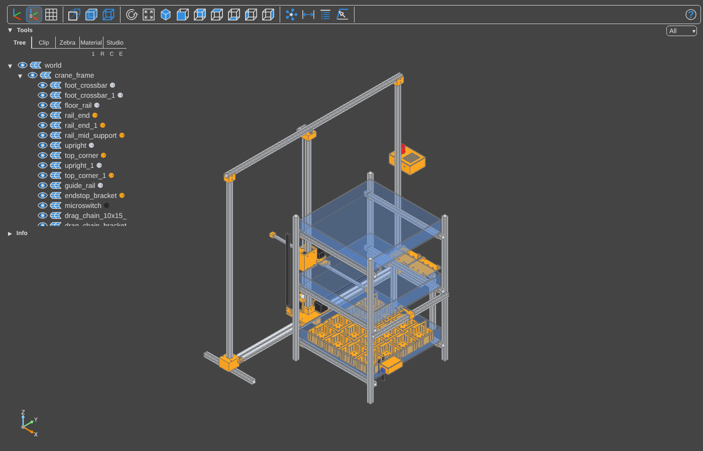
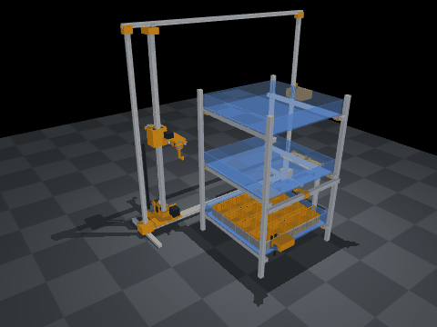
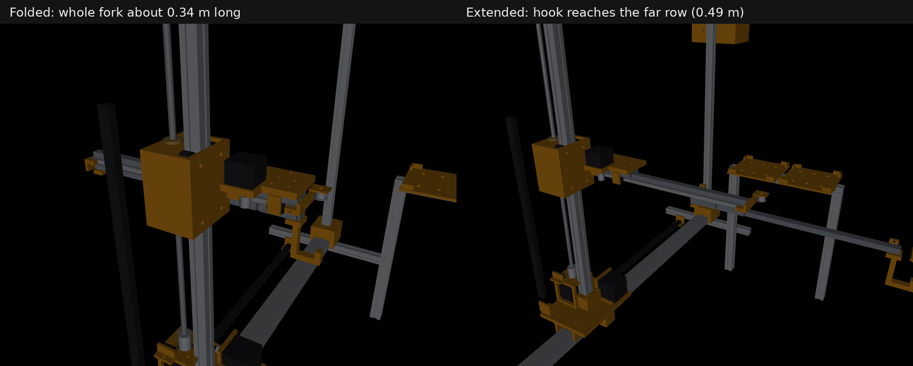
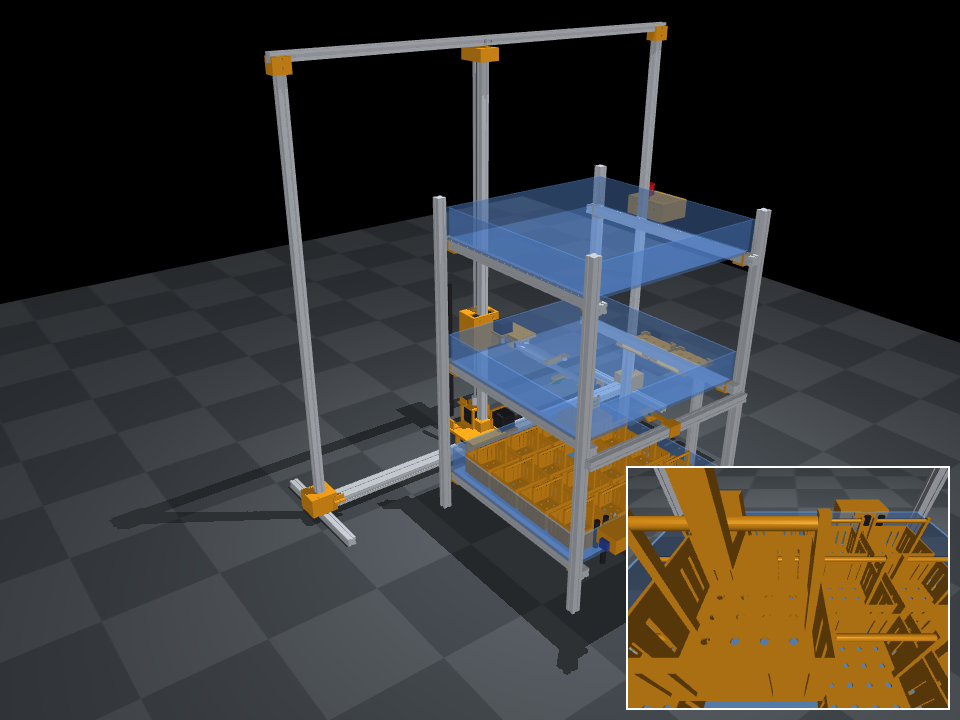

# rookery-crane

Parametric build123d CAD for the Rookery stacker crane. One spec file
(`crane.toml`) drives the 3D-printable parts, the bill of materials
([`bom.csv`](bom.csv), about $777), a Klipper `printer.cfg`, and a MuJoCo model
that uses Rookery's joint names (`rail_y`, `mast_z`, `arm_x`, plus a locked
`lift` and the fork's `arm_mid`).

**Status in Rookery:** this package stands on its own. The sim in `scene/` and
`crates/` still drives the old straight arm, and nothing there reads this model
yet. Fitting the fork to Rookery's rack (its 120 mm boxes, 0.15 m pitch and
rack3 shelves) is planned as separate, reviewed changes to the scene builder,
the mast crate, `limits.rs` and the gates. The old arm is kept on the
`backup/old-crane` branch.





## See it in build123d

1. Install the **OCP CAD Viewer** extension in VS Code.
2. Set up Python (3.11 or newer) once:
   ```bash
   cd hardware/crane          # from the repo root
   python3 -m venv .venv && source .venv/bin/activate
   pip install -e ".[dev]"
   ```
3. Open this folder in VS Code, choose the `.venv` interpreter, click the OCP
   viewer icon in the sidebar to start the viewer, then open `show.py` and run it.

From a terminal (with the viewer open in VS Code):

```bash
python show.py                     # home pose
python show.py pick:0,1,2          # tier 0, row 1, column 2 lifted clear of the tub
python show.py engage:0,3,0        # hook under that handle, before the lift
python show.py mast_z=0.7 arm_x=0.3
```

If the viewer isn't running, `show.py` writes `out/rookery_crane.glb` instead,
which any glTF viewer opens.

## See one part at a time

`python -m crane parts` (also part of `build`) writes `out/parts/`: one STEP,
one STL and one picture for every piece, printed and bought, plus
`out/parts/index.html`, a page with every part as a card. Open that page in a
browser to browse the kit.

```bash
python show_part.py --list              # every part name
python show_part.py truck_cheek         # one part in the OCP CAD Viewer
python show_part.py truck_cheek --flat  # turned the way it prints
python show_part.py nema17 --step       # open the exported STEP file itself
```

The STEP files open in any CAD program (FreeCAD, Fusion, Onshape). On a Mac,
select an STL in Finder and press Space for a quick look. Print from
`out/stl/`, not `out/parts/`: the print files are already turned flat.

## Rookery presets

`presets/` holds the crane fitted to Rookery's scenes (fit study, row 2.0 of the
crane swap plan): `rookery_rack3.toml` for rack3's three one-deep shelves and
`rookery_tray.toml` for the single 4 x 4 tray, with 0.46 m fork stages.
`tests/test_rookery_fit.py` checks them against `scene/generated/`. Two known
gaps are strict xfails until later rows: rack3's shelf pitch (regenerated with
`shelf_gap` 0.17), and the J-hook setting Rookery's 120 mm boxes 8-33 mm off
the exit slot (the hook becomes Rookery's 30 mm saddle).

```bash
python -m crane --spec presets/rookery_rack3.toml check
python -m crane --spec presets/rookery_rack3.toml pick --cell 2 0 3
```

## Other commands

```bash
python -m crane check      # validate crane.toml, print joint ranges
python -m crane build      # out/: stl/ + PRINT_LIST.md, bom.csv, klipper/printer.cfg,
                           #       mujoco/crane.xml + preview.xml, crane.json, STEP assembly
python -m crane bom        # rewrite the committed bom.csv after changing crane.toml or the catalogue
python -m crane pick       # run a pick-and-place in MuJoCo; exits 1 if the box misses its slot by > 5 mm
python -m crane view       # MuJoCo viewer: drag the sliders in the Control panel (right side)
python -m crane view --pick --speed 2    # watch a pick and place, then drive it yourself
python -m crane view --inset cam_tier_0 # inset another camera (--inset none for no inset)
python -m pytest -q        # 56 tests (4 known xfails), about 2 min
```

On a Mac, `view` needs MuJoCo's `mjpython` launcher and switches to it by
itself, so start it with plain `python`. (`mjpython -m mujoco.viewer` fails with
"Caught an unknown exception!": that app wants the main thread, which mjpython
keeps. `python -m crane view --classic` opens that app the right way.)

Edit any number in `crane.toml` and rerun. If the change can't work (the mast
can't reach the top tier, the arm won't fit the shelf gap, a part won't fit
your bed), `CraneSpec` refuses it and lists every reason at once.

## How the code is organised

```
 crane.toml ──► CraneSpec «Parameter Object»  frozen, validated, everything else derived
                    │
                    ▼
 build_crane() «Director» ──► CraneBuilder «Builder» ──asks──► PartFactory «Abstract Factory»
                    │                                          ├─ PrintedPart «Template Method»  parts/printed.py
                    │                                          └─ VendorPart  «Adapter»          parts/vendor.py + catalog.py «Flyweight»
                    ▼                       declared mounts ──► MountRegistry «Registry»
            BodyNode tree «Composite»
            world ─┬─ crane_frame
                   ├─ fixtures (exit tray, camera)
                   ├─ rack (preview only)
                   └─ truck ── carriage ─┬─ arm (fork top stage) ── hook
                                         └─ fork_mid (middle stage, follows arm_x at 1/2)
                    │
       accept(visitor) «Visitor»
   ┌────────────┬─────────────┬────────────┬──────────────┬──────────────┐
 ViewerVisitor MjcfVisitor   StlVisitor   BomVisitor    KlipperVisitor  PartsKitVisitor
 show.py       crane.xml     stl/*.stl    bom.csv       printer.cfg     parts/<kind>/<key>.step
               preview.xml      └── MeshExporter «Strategy»: STL / OBJ / STEP        └── PreviewRenderer «Strategy», KitIndexPage «Builder»
```

| Pattern | Where | Job |
|---|---|---|
| Parameter Object | `spec.py` | One frozen set of numbers; derived values are properties, so nothing can disagree |
| Builder + Director | `builder.py` | Places every part at the home pose; `build_crane` is the standard order |
| Composite | `tree.py` | Bodies contain parts and bodies, in exactly the MuJoCo body nesting |
| Visitor | `visitors/` | Each output is one class walking the same tree |
| Abstract Factory + Registry | `parts/factory.py` | Parts made by name; printed parts register themselves with `@printed` |
| Template Method | `parts/base.py` | Every printed part: body, features, fasteners, bed check, same order |
| Adapter | `parts/base.py` | Bought items look like parts to everything else |
| Flyweight | `catalog.py`, factory cache | One catalogue entry and one solid shared by every copy |
| Registry | `registry.py` | Each sensor, switch and cable port declared once, next to its geometry |
| Strategy | `exporters.py` | Mesh format swappable without touching the visitors |
| Command / Macro Command | `motion.py` | Pick and place as moves, mirroring Rookery's `MoveCommand` |
| Facade | `show.py`, `show_part.py` | One call to see the crane, or one part |
| Builder | `visitors/parts_kit.py` | `KitIndexPage` puts the parts index together section by section |
| Null Object | `preview.py` | `NullRenderer` skips pictures without any `if` in the visitor |

## The telescopic fork

The X axis is a two-stage telescopic fork, like the forks on pallet stacker
cranes: three 320 mm stages that fold flush, so nothing long sticks out behind
the mast. Folded, it reaches about 0.22 m behind the mast (the old 600 mm rail
reached about 0.52 m). Extended, the hook gets to 0.49 m, past the far row.



```
side view (folded)                          extended
  carriage ▓▓▓▓ (2 fixed blocks)              carriage ▓▓▓▓
  ══════════════ rail A  ┐ middle stage       ══════════════════ middle (moves u)
  ▔▔▔▔▔▔▔▔▔▔▔▔▔▔ bar     ┘ (2 blocks under       ══════════════════ rail B (moves 2u)
  ══════════════ rail B   its front)                               ┗J hook
               ┗J hook

  pinion ──belt rack──► middle stage moves u
  extend belt:  carriage ─► idler (middle FRONT) ─► top stage REAR   } top stage
  retract belt: carriage ─► idler (middle REAR)  ─► top stage FRONT  } moves 2u
```

In MuJoCo the middle stage is a fifth joint, `arm_mid`, after Rookery's four.
Nothing drives it: an `<equality>` keeps it at half of `arm_x`, which is what
the belts do on the real crane. Klipper's X still means the hook's cup; its
`rotation_distance` is 80 mm because one pinion turn moves the hook twice the
belt length.

## The hook camera

A Camera Module 3 Wide hangs under the hook rail, 6 cm behind the hook,
tilted 45 degrees down. It rides out with the fork, so it always sees the
hook, the handle it is about to pick and the box. In MuJoCo it is the camera
`cam_hook`, and `python -m crane view` shows its picture live in the bottom
right of the window.



For the real crane, the camera's cable has to follow the fork out and back
and run through both drag chains, about 3 m in all. That is too long for a
CSI ribbon, so the BOM has a CSI-to-HDMI extender pair: HDMI cable flexes in
a drag chain. The Pi 5 has two camera ports, one for each camera.

## Frame and joints

Y runs along the aisle (the floor rail), X into the rack, Z up, all in metres.
The three joint values are the world position of the hook's cup, so a cell's
coordinates are the joint targets, in MuJoCo, in Rookery and in Klipper (mm).
The `lift` joint is kept for Rookery but locked: the hook engages by moving the
mast down `engage_drop` (12 mm), sliding under the bar, and lifting.

## Things to check before printing or wiring

- `SKR_PICO_HOLES` in `parts/printed.py` is a placeholder. Check it against BTT's drawing.
- The pin names in `klipper/printer.cfg` follow BTT's SKR Pico sample config. Check them before powering anything.
- The Y belt path (flat belt on the rail top, omega wrap through the truck) is drawn but not modelled tooth by tooth. Dry-fit it first.
- Vendor parts are stand-in shapes with the right outside size, not supplier CAD.
- The two differential belts on the fork are drawn as their anchors and idlers, not tooth by tooth. Tension them so the hook can't drift relative to the middle stage.
